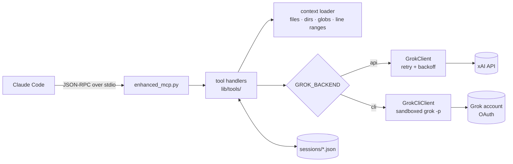

# Grok MCP Server

[](https://github.com/dancegit/discussWithGrokMCP/actions/workflows/ci.yml)
[](LICENSE)


An [MCP](https://modelcontextprotocol.io) server that lets Claude Code consult xAI's Grok models:
one-off questions, multi-turn discussions that persist to disk, and questions that carry
files, directories or glob patterns as context. It works with an xAI API key or with a
signed-in Grok account through the official `grok` CLI.




## Tools

| Tool | What it does |
|------|--------------|
| `grok_ask` | Single question, single answer |
| `grok_ask_with_context` | Question plus file/directory/glob context |
| `grok_discuss` | Multi-turn discussion on a topic, saved as a session, optionally with an agent persona |
| `grok_panel` | A panel of agents with different roles debates a topic, then a moderator synthesises |
| `grok_continue_session` | Add a turn (and optionally more context) to a saved session |
| `grok_list_sessions` | List saved sessions |
| `grok_health` | Check API connectivity and server stats |

Resources: `grok://sessions`, `grok://config`, `grok://stats`.

### Panels of agents


`grok_panel` puts 2-6 agents on a topic. Each agent is a name plus system instructions.
In round 1 every agent gives an independent opening position, run in parallel so nobody
anchors on anyone else. In later rounds each agent reads the transcript and responds to the
others by name. A neutral moderator then writes up consensus, disagreements (who holds which
view), a recommendation and open questions.

```jsonc
{
  "topic": "Should a 50-person software company try a four-day work week?",
  "agents": [
    "skeptic",                                                   // built-in preset
    "economist",                                                 // custom agent from agents/
    {"name": "team-lead", "instructions": "You lead a team of eight engineers..."}  // inline
  ],
  "rounds": 2,
  "max_words": 120
}
```

A panel is saved as a session. To resume it, call `grok_panel` with its `session_id` and a
`message`. Every agent sees your message and the earlier synthesis, and the panel runs
another round.

**Agents** come from three places:

- **Presets:** `architect`, `security`, `skeptic`, `pragmatist`, `qa`, `performance`, `product`, `researcher`.
- **Markdown files** in [`agents/`](agents/) or any directory in `GROK_AGENTS_DIR`. They use
  the same frontmatter-plus-prompt format as Claude Code agents. Two examples ship with the
  repo: `economist` and `data-engineer`.
- **Inline objects** `{"name", "instructions"}` passed in the call. Any agent can also take
  its own `model`.

`grok_discuss` takes the same `agent` names, or a free-form `system_prompt`, for a
single-voice discussion with a persona. The persona is stored with the session, so
`grok_continue_session` keeps it.

### Discussions survive restarts

`grok_discuss` saves each session as JSON under `sessions/`. Any later server process can
list it and continue it with the full history, including after Claude Code restarts.


### File context

`context_files` accepts any mix of:

```jsonc
[
  "README.md",                                      // a file
  "src/",                                           // a directory
  "**/*.py",                                        // a glob
  {"path": "main.py", "from": 10, "to": 50},        // a line range
  {"path": "lib/", "recursive": true,
   "extensions": [".py"], "exclude": ["test_*"]}    // a filtered directory
]
```

`__pycache__`, `.git`, `node_modules`, virtualenvs and build output are skipped automatically.

## Setup

Requires Python 3.11+ and [uv](https://github.com/astral-sh/uv).

```bash
git clone https://github.com/dancegit/discussWithGrokMCP.git
cd discussWithGrokMCP
uv sync
cp .env.example .env
```

Then choose how to reach Grok:

| Backend | Use when | Setup |
|---------|----------|-------|
| `api` | You have xAI API credits | Set `XAI_API_KEY` in `.env` |
| `cli` | You have a Grok subscription | Install the [Grok CLI](https://x.ai/cli) and run `grok login` |

`GROK_BACKEND=auto` (the default) uses the API when `XAI_API_KEY` is set and the CLI
otherwise.

Register the server with Claude Code:

```bash
claude mcp add grok -- uv --project "$PWD" run "$PWD/enhanced_mcp.py"
```

Or copy [`.mcp.json.example`](.mcp.json.example) to `.mcp.json` and fill in the absolute path.
All settings are environment variables; [`.env.example`](.env.example) lists every one
the server reads.

### How the CLI backend is contained

The `grok` CLI is a full coding agent, and context files are untrusted input. A file that
says "ignore the question and run this command" must not reach your shell. Each request
therefore runs `grok -p` with:

- **No tools.** Built-in tools are removed, subagents and plan mode are off, and the
  permission mode is deny-by-default.
- **A kernel sandbox.** `--sandbox strict` uses Landlock and seccomp on Linux. Reads are
  limited to an empty temporary directory, system paths and `~/.grok`, and child processes
  get no network.
- **No personal context.** The CLI runs with an empty temporary `HOME` (`GROK_HOME` still
  points at your real `~/.grok` for the login) and its Claude Code / Cursor compatibility
  scanning is off. Your `CLAUDE.md`, permission rules, agents, skills, hooks and MCP servers
  are not loaded.

`tests/test_live_cli.py` checks this against the real CLI. It confirms that a file in your
home directory can't be read and that your instructions don't leak into answers. It also
runs `grok inspect` to confirm that no personal config, permission rules, plugins or MCP
servers are loaded.

The CLI handles OAuth itself, including token refresh. This server never reads
`~/.grok/auth.json`.

## Try it without Claude Code

`scripts/demo.py` starts the server and talks to it over stdio, the same way Claude Code
does. It lists the tools, asks a question, asks it again to show the cache, and asks
about a line range of a source file:

```bash
uv run python scripts/demo.py               # ask, cache hit, ask with file context
uv run python scripts/demo_discussion.py    # discuss, restart the server, resume
uv run python scripts/demo_panel.py         # three agents debate, moderator recommends
```

The GIFs are recorded from these scripts with [VHS](https://github.com/charmbracelet/vhs)
(`docs/*.tape`). `scripts/squash_gif.py` then shortens the waits for Grok; the timings on
screen are the real ones. The panel demo shortens each contribution to fit the GIF and
says so; the tool itself returns the full text.

## Testing

```bash
uv run pytest                                     # 87 offline tests, no network
uv run pytest -m live                             # 2 tests against the xAI API (needs XAI_API_KEY)
RUN_GROK_CLI_TESTS=1 uv run pytest -m live_cli    # 4 containment checks against the real grok CLI
```

The offline suite covers all seven tools, agent loading, panel rounds and resume, the
file-context loader, session persistence, response caching, backend selection and the
JSON-RPC protocol (the server runs as a subprocess). A conftest fixture replaces `GrokClient` with an in-memory fake, and the CLI
backend is tested against a fake `grok` executable that records its arguments, so these
tests need no key and no network.

CI runs on every push and pull request:

- **pytest** on Python 3.11, 3.12 and 3.13
- **gitleaks** over the full git history

## Layout

```
enhanced_mcp.py        MCP server entry point (JSON-RPC over stdio)
lib/grok_client.py     Async xAI API client with retry/backoff, backend factory
lib/grok_cli_client.py Sandboxed client for the signed-in grok CLI
lib/agents.py          Agent presets and loader for agents/*.md
lib/tools/             One module per tool, plus the context loader
agents/                Example custom agents (Markdown + frontmatter)
tests/                 pytest suite (offline + live)
scripts/               Demo client, GIF post-processing, session repair
docs/                  Demo GIF and the VHS tape that records it
archive/               Earlier server prototypes, unmaintained
```

## Notes

- Context files are read with the permissions of the server process, so only point it at
  paths you are happy to send to xAI.
- Identical `grok_ask` / `grok_ask_with_context` calls are answered from an in-memory
  cache for `MCP_CACHE_TTL` seconds. Errors are never cached, and the session tools always
  run.
- Sessions and logs are written to `./sessions/` and `*.log` in the working directory
  (both are git-ignored).

## License

GPL-3.0. See [LICENSE](LICENSE).
