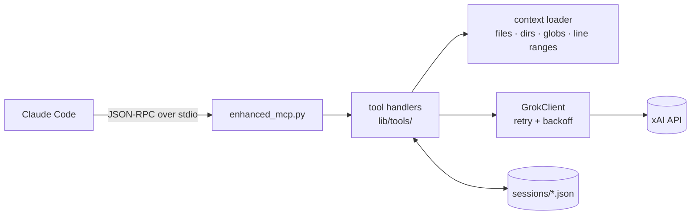

# Grok MCP Server

[](https://github.com/dancegit/discussWithGrokMCP/actions/workflows/ci.yml)
[](LICENSE)


An [MCP](https://modelcontextprotocol.io) server that lets Claude Code consult xAI's Grok models:
one-off questions, multi-turn discussions that persist to disk, and questions that carry
files, directories or glob patterns as context.



## Tools

| Tool | What it does |
|------|--------------|
| `grok_ask` | Single question, single answer |
| `grok_ask_with_context` | Question plus file/directory/glob context |
| `grok_discuss` | Multi-turn discussion on a topic, saved as a session |
| `grok_continue_session` | Add a turn (and optionally more context) to a saved session |
| `grok_list_sessions` | List saved sessions |
| `grok_health` | Check API connectivity and server stats |

Resources: `grok://sessions`, `grok://config`, `grok://stats`.

`context_files` accepts any mix of:

```jsonc
[
  "README.md",                                      // a file
  "src/",                                           // a directory
  "**/*.py",                                        // a glob
  {"path": "main.py", "from": 10, "to": 50},        // a line range
  {"path": "lib/", "recursive": true,
   "extensions": [".py"], "exclude": ["test_*"]}    // a filtered directory
]
```

`__pycache__`, `.git`, `node_modules`, virtualenvs and build output are skipped automatically.

## Setup

Requires Python 3.11+, [uv](https://github.com/astral-sh/uv) and an xAI API key.

```bash
git clone https://github.com/dancegit/discussWithGrokMCP.git
cd discussWithGrokMCP
uv sync
cp .env.example .env   # then set XAI_API_KEY
```

Register it with Claude Code:

```bash
claude mcp add grok -- uv --project "$PWD" run "$PWD/enhanced_mcp.py"
```

Or copy [`.mcp.json.example`](.mcp.json.example) to `.mcp.json` and fill in the absolute path.
All settings are environment variables; [`.env.example`](.env.example) lists every one
the server reads.

## Try it without Claude Code

`scripts/demo.py` starts the server and talks to it over stdio, the same way Claude Code
does. It lists the tools, asks a question, asks it again to show the cache, and asks
about a line range of a source file:

```bash
uv run python scripts/demo.py
```

## Testing

```bash
uv run pytest            # 71 offline tests; the xAI client is faked
uv run pytest -m live    # 2 tests against the real API (needs XAI_API_KEY)
```

The offline suite covers the six tools, the file-context loader, session persistence,
response caching and the JSON-RPC protocol (the server runs as a subprocess). A conftest
fixture replaces `GrokClient` with an in-memory fake, so these tests need no key and no
network.

CI runs on every push and pull request:

- **pytest** on Python 3.11, 3.12 and 3.13
- **gitleaks** over the full git history

## Layout

```
enhanced_mcp.py        MCP server entry point (JSON-RPC over stdio)
lib/grok_client.py     Async xAI client with retry/backoff
lib/tools/             One module per tool, plus the context loader
tests/                 pytest suite (offline + live)
scripts/               Demo client and session-repair utility
archive/               Earlier server prototypes, unmaintained
```

## Notes

- Context files are read with the permissions of the server process, so only point it at
  paths you are happy to send to xAI.
- Identical `grok_ask` / `grok_ask_with_context` calls are answered from an in-memory
  cache for `MCP_CACHE_TTL` seconds. Errors are never cached, and the session tools always
  run.
- Sessions and logs are written to `./sessions/` and `*.log` in the working directory
  (both are git-ignored).

## License

GPL-3.0. See [LICENSE](LICENSE).
